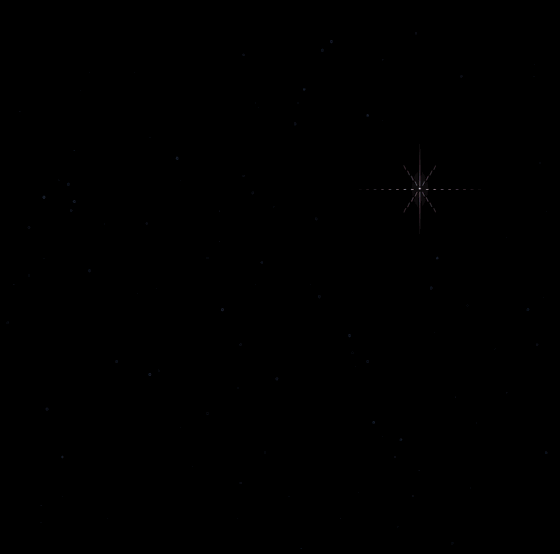
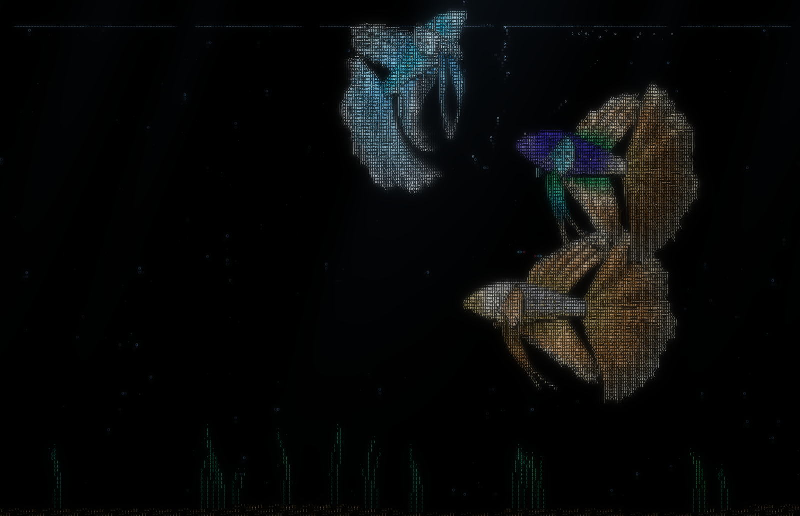
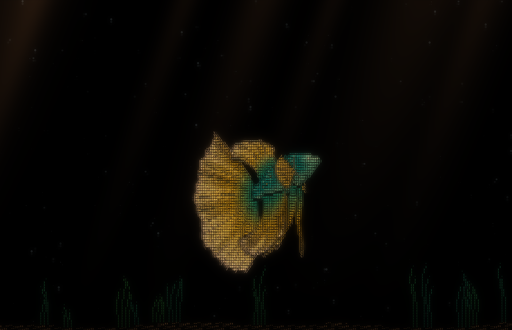

# Betta Lite

An endless take on [THE BETTA FISH IN ASCII](https://github.com/dwcminh/ascii-art/tree/main/BETTA-FISH) by [@dwcminh.ascii](https://instagram.com/dwcminh.ascii) as your macOS desktop wallpaper, in Swift and Metal, using a fraction
of the CPU.

The fish draws itself exactly as in the original, then swims for ever, with real betta habits, in a
tank that can span all your screens. Everything is set from the fish icon in the menu bar, from a few
choices each. Its big sibling, [Betta Aquarium](https://github.com/MJasevicius/betta-aquarium), adds
names, personalities, moods, memory, growing up, environments, weather, a screen saver and a full
settings window.



**▶ [Watch the demo](https://github.com/MJasevicius/betta-lite/releases/latest/download/betta-lite-demo.mp4)**
(40 seconds: it draws itself, swims, is fed, and the glass is tapped)

| Three fish in the tank | The light at sunrise |
|---|---|
|  |  |

## Download

Get **betta-lite-macos.zip** from the [latest release](https://github.com/MJasevicius/betta-lite/releases/latest),
unzip it, and move **Betta Lite.app** to Applications. It runs on Apple silicon and Intel Macs with macOS
14 or later.

It isn't notarized by Apple (that takes a paid developer account), so the first time, macOS won't
open it. Either try to open it once, then go to **System Settings ▸ Privacy & Security** and click
**Open Anyway**; or, in Terminal:

```
xattr -dr com.apple.quarantine "/Applications/Betta Lite.app"
```

## Build it yourself

```
git clone https://github.com/MJasevicius/betta-lite
cd betta-lite
./make-app.sh
```

This builds **Betta Lite.app** (with an icon the fish draws itself) and puts it in
`~/Applications`. Open it from there or with Spotlight. It needs macOS 14 or later and the Xcode Command Line Tools with Swift 5.9 or later
(`xcode-select --install`). The app is signed only for your own Mac (ad hoc), as it is built there.

Betta Lite and Betta Aquarium can't run at the same time (both are the desktop): quit one (fish icon ▸
Quit) before opening the other. `swift run -c release` runs it straight from here, printing what it costs.

## The menu

- **Pause / Resume**, and **Feed**: a few pellets drop near each fish, and they chase and eat them.
- **Look**
  - **Fish Size:** Small, Medium or Large. A smaller fish has more room to swim.
  - **Colours:** change through all sets, through your favourites, or with the time of day, or keep
    one set; choose your **Favourites**; how often new colours come (2 s as in the original, up to 2
    minutes).
  - **Glow** and **Trail**, from off to strong or long.
  - **Letters:** the font (Courier as in the original, Menlo, Monaco, SF Mono), and the letters that
    fill the fish (Classic, Dense, Blocky, Minimal).
  - **Water:** light rays (faint to very strong), caustics, a water surface that ripples, sand and
    plants, darker edges. The scenery keeps its size whatever the fish size.
- **Behaviour**
  - **Number of Fish:** 1 to 6, each with its own colours and timing, spreading out as the room allows.
  - **Betta Habits:** flaring, darting up for air, blowing a bubble nest at the top.
  - **Pace:** Lively, Calm or Very Calm.
  - **Mouse:** ignore it, come and look at it, or keep away from it.
  - **Tap the Glass:** click bare desktop and the fish on that screen dart away; a few seconds later one
    comes back to see what it was.
  - **Gets Hungry:** after 6, 12 or 24 hours without food (or never), they wait at the front of the
    glass until fed.
  - **Day and Night:** golden light at sunrise and sunset (5–9 and 20–0:00), dim and sleepy at night.
  - **Tank Mates:** a school of neon tetras far behind.
- **One Tank Across All Screens**, **Pause on Battery**, **Pause in Low Power Mode**, **Open at Login**.

## How it works

- **Same fish:** the geometry, lighting and letters are ported line by line from the Python; its first
  ~4 s, while it draws itself, match `betta_fish.py` cell for cell.
- **Endless:** then it never loops. A chain of legs (rest, turn, swim, flare, gulp of air, nest) is
  drawn at random; food, the mouse or a tap cut in from where the fish is, at the speed it has, so it
  never jerks. The tail and veils run late, it tilts as it climbs, and beats harder when it goes faster.
- **One tank:** the screens are laid out as arranged, and the water spans them all. Two grids of letters
  lie over it: the fish's, as fine as the fish size asks, and the scenery's, always the same size.
- **Cheap:** about 0.7 ms of CPU a frame per fish. Only the points in front, one per cell, are lit; the
  fins' waves are worked out per row and column; the pose is a table; the GPU draws; a 30 Hz display
  link drives it; screens covered by windows aren't drawn.

| File | What is in it |
|---|---|
| `Fish.swift` | the fish's shape, fins, colours and pose, from the Python |
| `Tables.swift` | the original's random numbers for the glitter on the fins |
| `Motion.swift` | where a fish goes and what it does |
| `Betta.swift` | one fish: what it does each frame, and its points |
| `Tank.swift` | the water over every screen, the fish, food, ripples, taps, scenery |
| `Renderer.swift` | Metal: letters, glow, trails, rays, caustics |
| `Wallpaper.swift` | a desktop-level window per screen |
| `App.swift`, `Settings.swift` | the app, the menu, and what it remembers |
| `main.swift` | starting up, and the tools below |

## Tools for checking

```
B=$(swift build -c release --show-bin-path)/BettaLite
$B --bench                                   # CPU time per frame
$B --snap 300,900 --out DIR [--fish 3 --seabed --surface --company --rays 1 --caustics 1 --feed 270 --tap 600]
$B --path 10 [--fish 3 --feed --tap --hungry --night --surface]       # swim 10 minutes unseen: what did they do?
$B --dump 2.5 FILE                           # raw 113 x 103 grid, for diffing with the Python
$B --icon FILE                               # the app icon
$B --video FILE --seconds 40 [as --snap]      # an MP4 of the tank (--from S to start later, --width W)
$B --gif FILE --seconds 8 --fps 15 [as --snap] # an animated GIF
tools/make-media.sh                          # the README's pictures (media/) and the demo video (dist/)
tools/release.sh                             # the app for Apple silicon and Intel, zipped for a release (dist/)
python tools/compare.py                      # the first seconds against the Python, cell for cell*
```


\* `tools/compare.py` and `tools/export_tables.py` need the original: clone
[dwcminh/ascii-art](https://github.com/dwcminh/ascii-art) beside this repository (or set `BETTA_FISH_PY`
to where `betta_fish.py` is), and `pip install numpy pygame-ce`.

## What it keeps on your Mac, and removing it

- its settings: `~/Library/Preferences/io.github.mjasevicius.betta-lite.plist`
- with Open at Login: `~/Library/LaunchAgents/io.github.mjasevicius.betta-lite.plist`

It never uses the network. To remove it: quit it, turn off Open at Login (or delete the file above),
and delete the app and the settings file.

## Credits and terms

- The fish, its look and its motion are [THE BETTA FISH IN ASCII](https://github.com/dwcminh/ascii-art/tree/main/BETTA-FISH) by [@dwcminh.ascii](https://instagram.com/dwcminh.ascii) (`betta_fish.py`). This is a remix of it,
  published with @dwcminh.ascii's permission and under the same terms as the original
  ([LICENSE.txt](LICENSE.txt)): free for personal, non-commercial use; ask @dwcminh.ascii before any
  commercial use; never pass it off as your own.
- The caustics are adapted from the Shadertoy "Tileable Water Caustic" by Dave_Hoskins, after
  joltz0r (CC BY-NC-SA 3.0).
